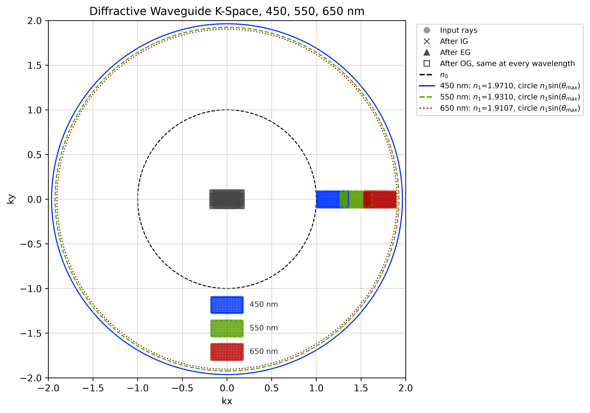
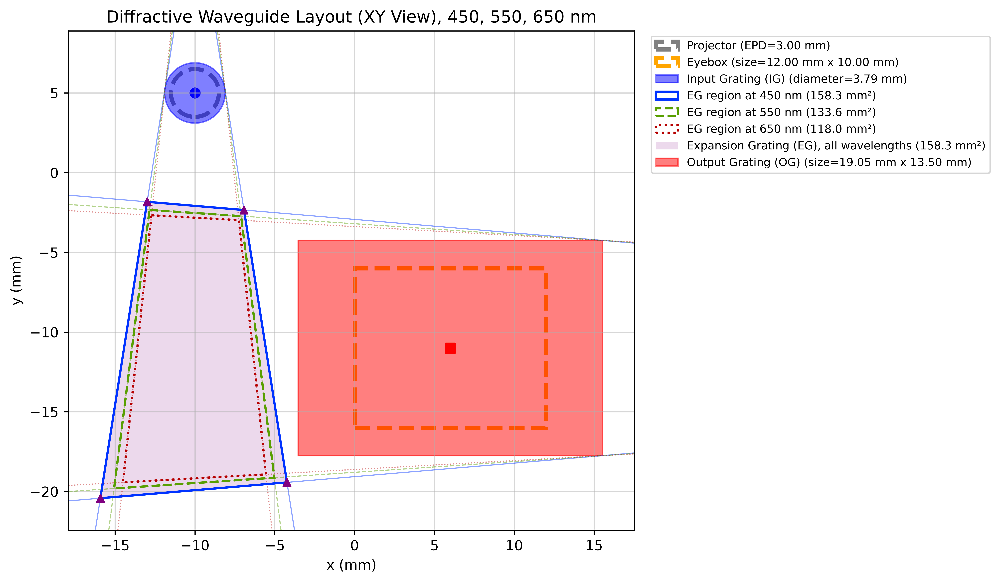
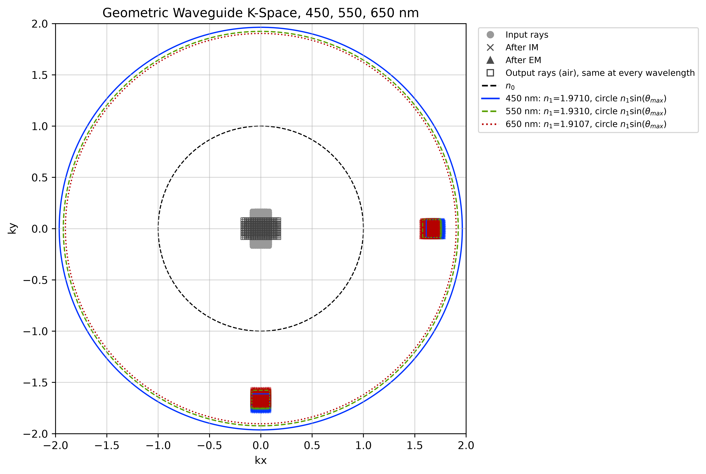
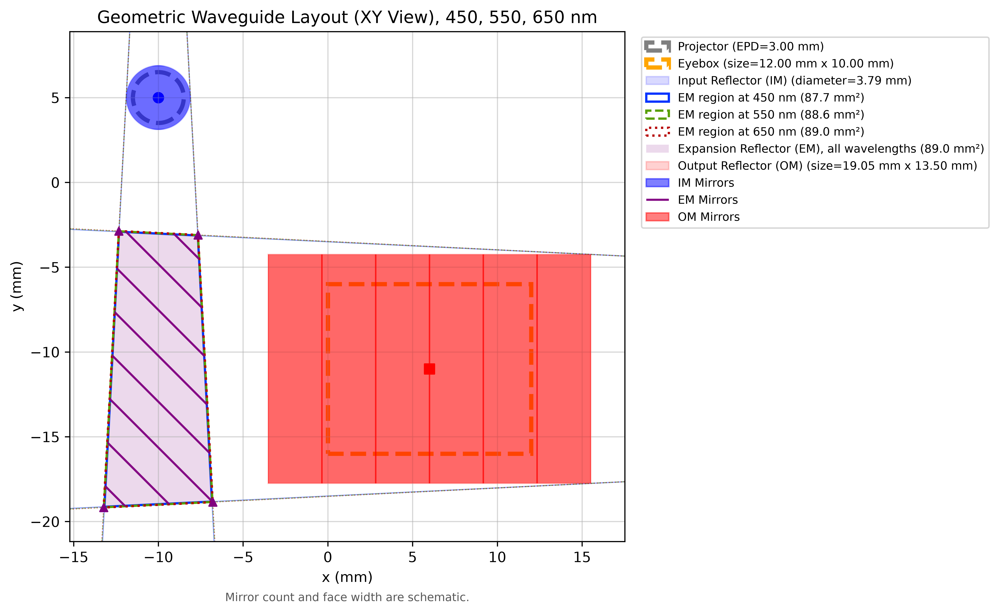
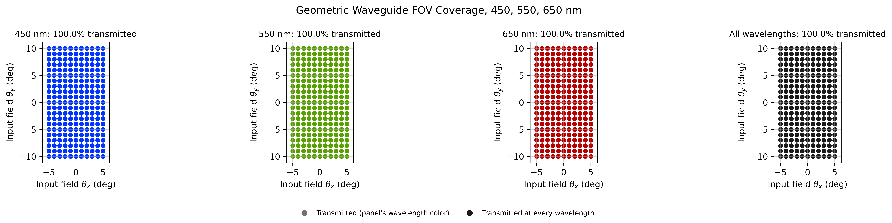

# Basic Waveguide Analysis

A Python tool for analyzing **diffractive** and **geometric** waveguides with input, expansion, and output couplers. It traces normalized wave vectors, checks guided-ray acceptance, estimates coupler footprints, and plots k-space and the XY layout, at one wavelength or across several (for example RGB).

Geometric waveguides use reflection inside the glass and conventional refraction at the flat entrance and exit surfaces. The code keeps the stage names `IG`, `EG`, and `OG`; plots label reflectors as `IM`, `EM`, and `OM`.

## Examples

<center></center>

<center></center>

Multi-wavelength (450, 550, 650 nm) runs of the same two designs:

<center></center>

<center></center>

<center></center>

<center></center>

## Files

| File | Purpose |
| --- | --- |
| `functions.py` | Vector rotations, 2D lines, convex hulls, and wavelength colors |
| `MaterialObject.py` | Refractive index models (constant, table, Sellmeier, Cauchy, Abbe) |
| `RayObject.py` | Ray wave vectors, field angles, positions, and copying |
| `GratingObject.py` | Grating diffraction |
| `ReflectorObject.py` | Specular reflection and mirror orientation |
| `WaveguideObject.py` | Waveguide construction, tracing, dimensions, and plots |
| `MultiWavelengthObject.py` | Runs a waveguide at several wavelengths and compares them |
| `waveguide_analysis.py` | Example parameter dictionaries and main program |

## Installation and running

Requirements: Python 3, NumPy, and Matplotlib. Keep the eight Python files in
the same folder and run these commands there:

```bash
python3 -m pip install numpy matplotlib
python3 waveguide_analysis.py
```

The script runs both example designs at one wavelength and again at 450, 532,
and 650 nm, prints their summaries, and saves ten figures in the current
working directory:

- `geometric_layout.png`, `geometric_k_space.png`
- `grating_layout.png`, `grating_k_space.png`
- `geometric_layout_rgb.png`, `geometric_k_space_rgb.png`, `geometric_fov_rgb.png`
- `grating_layout_rgb.png`, `grating_k_space_rgb.png`, `grating_fov_rgb.png`

## Configuration

Edit the parameter dictionaries in `waveguide_analysis.py`. Both designs
use the same structure:

```python
from waveguide_analysis import main

parameters = {
    "waveguide_type": "geometric",  # or "diffractive"
    "waveguide": {
        "wavelength": 450.0,
        "index_environment": 1.0,
        "index_substrate": 1.9710,
        "FOV": [10.0, 20.0],
        "alpha_im": 35.0,
        "ray_position_samples": [11, 21],
    },
    "layout_plot": {
        "filename": "geometric_layout.png",
        "mirror_counts": {"IG": 1, "EG": 8, "OG": 6},
        "mirror_fill": 1.0,
    },
    "k_space_plot": {
        "filename": "geometric_k_space.png",
    },
}

analysis = main(parameters)
```

For a diffractive design, use `"waveguide_type": "diffractive"` and replace
the `waveguide` settings with, for example:

```python
{
    "wavelength": 650.0,
    "grating_pitch": 380.0,
    "index_environment": 1.0,
    "index_substrate": 1.9107,
    "FOV": [20.0, 10.0],
    "ray_position_samples": [21, 11],
}
```

Unknown keys in `"waveguide"` or in the plot dictionaries raise an error, so a
misspelled parameter can no longer be silently ignored.

### Multiple wavelengths

Give `wavelength` as a list. `main()` then analyzes every wavelength, prints a
comparison table, and overlays the results. Add an optional `"fov_plot"` entry
to map which input fields survive at each wavelength:

```python
parameters["waveguide"]["wavelength"] = [450.0, 550.0, 650.0]
parameters["waveguide"]["index_substrate"] = {450.0: 1.9710, 550.0: 1.9310, 650.0: 1.9107}  # dispersion
parameters["fov_plot"] = {"filename": "geometric_fov_rgb.png"}
analysis = main(parameters)   # a MultiWavelengthWaveguide
```

What changes with wavelength:

- **Gratings** keep their period, so the normalized grating vector
  `lambda / period` scales with wavelength. The after-IG and after-EG k-space
  regions slide along the grating vectors; a field is lost where its region leaves the
  guided annulus `n0 <= |k| <= n1(lambda) sin(theta_max)`. The output direction of a
  closed grating loop does not depend on wavelength.
- **Mirrors** are achromatic. Only the substrate dispersion `n1(lambda)` changes the
  internal angles, the grazing-angle limit, and slightly the EM layout.
- The **EG footprint** differs per wavelength (shorter wavelengths spread wider in
  the diffractive design). The summary and layout plot also give the convex hull of
  all per-wavelength EG regions, a single footprint that serves every wavelength.

With a constant `index_substrate`, a geometric design gives the same result at
every wavelength.

### Dispersion

`index_substrate` and `index_environment` accept:

| Value | Meaning |
| --- | --- |
| `1.9107` | Constant index |
| `{450.0: 1.9710, 550.0: 1.9310, 650.0: 1.9107}` | Table in nm; interpolated linearly in 1/lambda² (a two-term Cauchy fit between points), with a warning when extrapolating |
| `Material.sellmeier(B, C)` | Sellmeier coefficients, lambda in um, `C` in um² |
| `Material.cauchy(A, B, C)` | `n = A + B/lambda² + C/lambda⁴`, lambda in um |
| `Material.from_abbe(nd, vd)` | Two-term Cauchy estimate from catalog `nd` and Abbe number |
| `lambda wl: ...` | Any function of wavelength in nm |

`Material` comes from `MaterialObject.py`. The example table only reuses the two
indices from the single-wavelength examples; replace it with your substrate's
Sellmeier data.

### Main parameters

| Parameter | Meaning / units |
| --- | --- |
| `wavelength` | Vacuum wavelength in nm, or a list of them for a multi-wavelength run |
| `grating_pitch` | Reference grating period, nm |
| `index_environment`, `index_substrate` | External and glass refractive indices, or dispersion models (see above) |
| `FOV` | Full input field `[horizontal, vertical]`, degrees |
| `ray_position_samples` | Angular sample counts `[Nx, Ny]` across the FOV |
| `alpha_im` | Input-mirror rotation for the geometric preset, degrees |
| `max_allowed_angle` | Maximum allowed internal angle from the slab normal, degrees |
| `EPD_projector`, `gap_projector` | Projector pupil diameter and gap, mm |
| `IG_origin`, `OG_origin` | Input and output region centers `[x, y]`, mm |
| `eyebox_size`, `eye_relief` | Eyebox `[width, height]` and distance from the guide, mm |
| `input_surface_normal`, `output_surface_normal` | Flat-interface normals; geometric defaults are `[0, 0, -1]` and `[0, 0, 1]` |

## Using the classes directly

```python
from WaveguideObject import Waveguide
from MultiWavelengthObject import MultiWavelengthWaveguide

wg = Waveguide.from_geometric_design(alpha_im=35.0)
# Alternatively: wg = Waveguide.from_grating_design(grating_pitch=380.0)

wg.analyze()
print(wg.IG_diameter, wg.OG_size, wg.output_FOV, wg.EG_corners)
output_rays_in_air = wg.trace_rays()
print(wg.rejected_percentages, wg.transmitted_percentage)

fig, ax = wg.plot_k_space(filename=None)
fig, ax = wg.plot_fov_coverage(filename=None)

green = wg.at_wavelength(532.0)  # copy at another wavelength

rgb = MultiWavelengthWaveguide(wg, [450.0, 532.0, 650.0])
rgb.print_summary()
blue = rgb[450.0]  # the Waveguide analyzed at 450 nm
print(rgb.common_transmitted_mask.mean(), rgb.combined_EG_footprint)
fig, ax = rgb.plot_k_space(filename=None)
fig, ax = rgb.plot_waveguide_layout(filename=None)
fig, axes = rgb.plot_fov_coverage(filename=None)
```

`print_summary()` refreshes and prints the analysis.
`plot_waveguide_layout()`, `plot_k_space()`, and `plot_fov_coverage()` return
`(fig, ax)` (`(fig, axes)` for the multi-wavelength FOV plot); `filename=None`
skips saving. `main()` returns the `Waveguide` or `MultiWavelengthWaveguide`.
In a multi-wavelength run, a wavelength with no guided field has no layout;
its reason is kept in `layout_errors` and printed instead of raising.

## Ray states

`N0` is the external index and `N1` is the substrate index at the analysis
wavelength. Wave vectors are normalized by the vacuum wavenumber, so a
propagating ray has `|K| = n`.

| Attribute | Geometric design | Diffractive design |
| --- | --- | --- |
| `incident_rays` / `rays0_air` | External input, `N0` | External input, `N0` |
| `rays0` | Before IM, inside glass, `N1` | Before IG, `N0` |
| `rays1`, `rays2` | After IM / EM, `N1` | After IG / EG, `N1` |
| `rays3` | After OM, before exit refraction, `N1` | After OG, `N0` |
| `output_rays` / `rays3_air` | External output, `N0` | External output, `N0` |

The `_air` names refer to the configured external medium. `k_points` uses external input/output vectors for plotting; `k_points_internal` retains the computational vectors. Both use keys `input`, `IG`, `EG`, and `OG`.

After `trace_rays()`, `field_angles[i]` is the input field of `incident_rays[i]`,
`ray_status[i]` is the stage where that ray was lost (`'IG'`, `'EG'`, `'OG'`, or
`None` if it reached the output), and `ray_indices[stage][j]` is the incident
index of the `j`-th ray in that stage's list. Field angles are measured from the
axis a ray travels along, so a ray tilted toward +x has a positive `theta_x` for
both +z and -z travel.

## Model limitations

-   The layout uses selected key rays and 2D line intersections. The EG
    left/right edges are the most divergent guided rays after IG, tangent to the
    IG circle. The top/bottom edges are the after-EG rays that feed the highest
    and lowest needed OG points: each output field needs only the eyebox shifted
    back by `eye_relief * tan(field)`. The layout assumes light leaves the IG
    toward -y and reaches the OG along +/-x.
-   The output FOV, and from it the OG size, comes from forward-traced fields.
    For the geometric preset the mirrors rotate the field, so the output FOV is the
    input FOV swapped. Sizing and layout use only fields that reach the output.
-   The multi-wavelength EG footprint is the convex hull of the per-wavelength
    regions, which can be slightly larger than their union.
-   Mirror counts and fill affect the schematic drawing only.
-   The model does not calculate full 3D surface intersections, slab bounce paths, polarization, or efficiency.
-   Rejected-ray percentages are sample counts relative to the incident count, not power losses.

## Revision notes

Fixes in this revision:

-   The example script used `samples_of_rays`, and the presets used `eyebox_origin`,
    `input_interface_normal`, and `output_interface_normal`. The waveguide ignored all
    four silently. They are renamed to the real parameters, and unknown parameters now raise.
-   EG top/bottom key rays used the wrong fields. The diffractive layout used
    (+FOV_x/2, -FOV_y/2) at the OG top corner where (-FOV_x/2, -FOV_y/2) is needed,
    which put the EG top edge 0.26 mm too low and cut that corner of the image
    from the upper-right eyebox. The geometric layout used input-FOV fields that the
    mirrors never produce, which made the EM about 2.5 mm longer than needed.
-   OG rejections were computed but discarded, and an evanescent OG order crashed the
    trace. They are now counted, reported, and included in `rejected_percentages`.
-   `print_summary()` failed for reflector waveguides not built by
    `from_geometric_design()` (no `alpha_im`).
-   The layout crashed with an unhelpful error when no corner field was guided (for
    example at another wavelength). It now uses the guided fields, or raises a clear error.
-   Rays travelling toward -z reported field angles with the wrong sign.
-   Saved layouts clipped the "Mirror count and face width are schematic" note.
