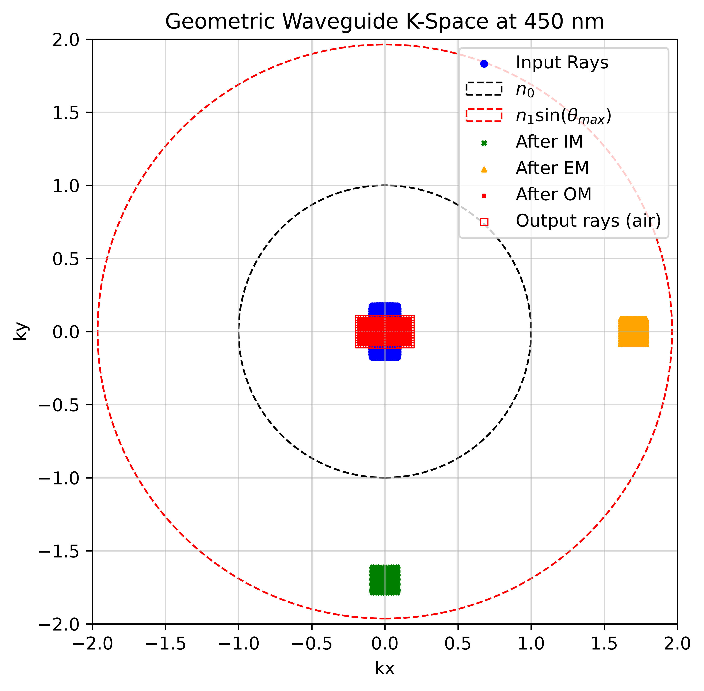
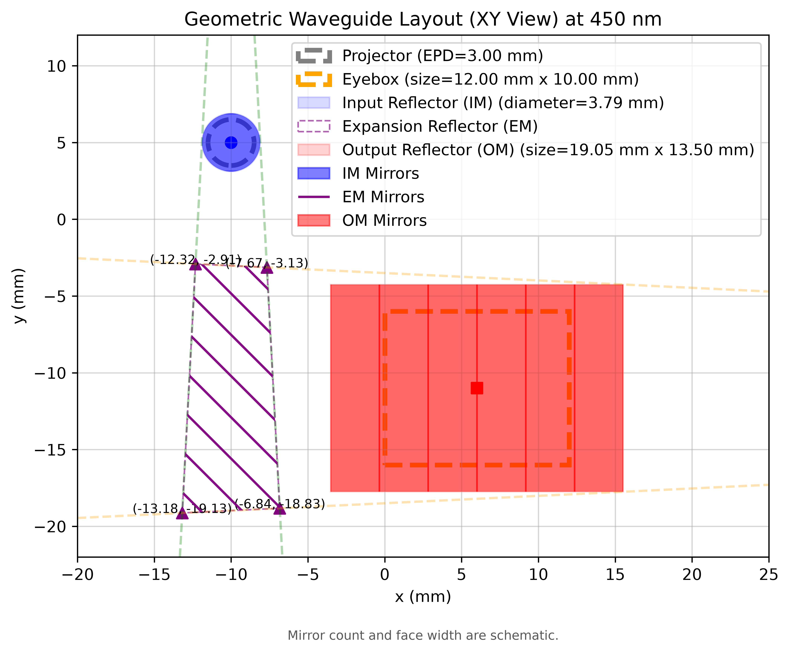
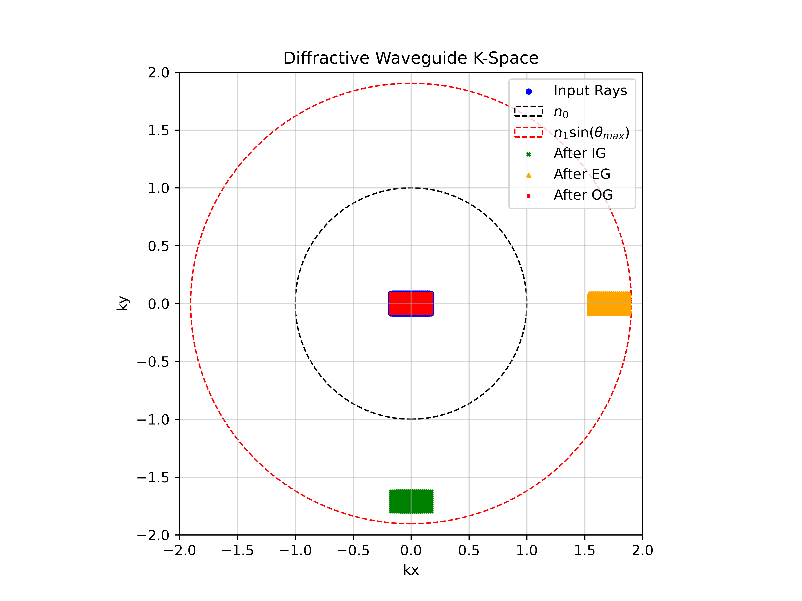
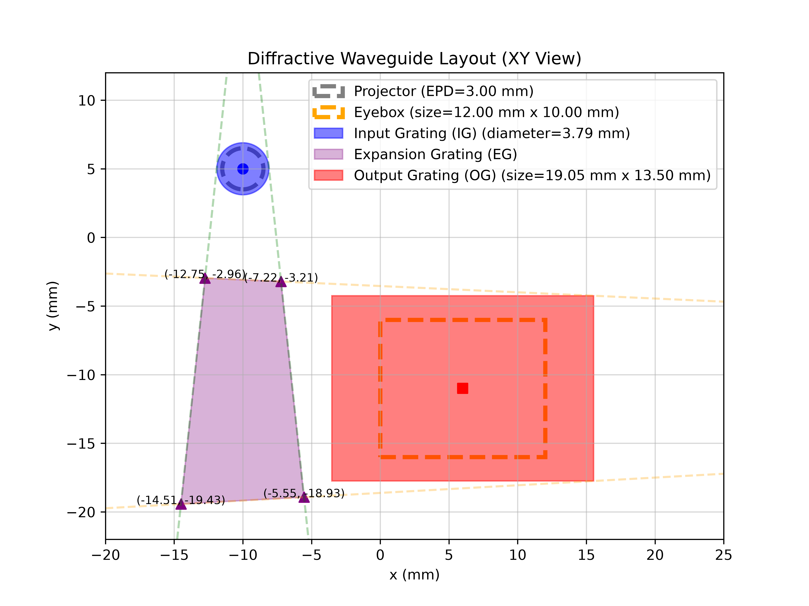

# Basic Waveguide Analysis

A Python tool for analyzing **diffractive** and **geometric** waveguides with input, expansion, and output couplers. It traces normalized wave vectors, checks guided-ray acceptance, estimates coupler footprints, and plots k-space and the XY layout.

Geometric waveguides use reflection inside the glass and conventional refraction at the flat entrance and exit surfaces. The code keeps the stage names `IG`, `EG`, and `OG`; plots label reflectors as `IM`, `EM`, and `OM`.

## Examples

<center></center>

<center></center>

## Files

| File | Purpose |
| --- | --- |
| `waveguide_analysis.py` | Example parameter dictionaries and main program |
| `WaveguideObject.py` | Waveguide construction, tracing, dimensions, and plots |
| `RayObject.py` | Ray wave vectors, field angles, positions, and copying |
| `GratingObject.py` | Grating diffraction |
| `ReflectorObject.py` | Specular reflection and mirror orientation |
| `functions.py` | Vector rotations, normalization, and 2D line intersections |

## Installation and running

Requirements: Python 3, NumPy, and Matplotlib. Keep the six Python files in
the same folder and run these commands there:

```bash
python3 -m pip install numpy matplotlib
python3 waveguide_analysis.py
```

The script runs both example designs, prints their summaries, and saves
four figures in the current working directory:

- `geometric_layout.png`
- `geometric_k_space.png`
- `grating_layout.png`
- `grating_k_space.png`

## Configuration

Edit the parameter dictionaries in `waveguide_analysis.py`. Both designs
use the same structure:

```python
from waveguide_analysis import main

parameters = {
    "waveguide_type": "geometric",  # or "diffractive"
    "waveguide": {
        "wavelength": 450.0,
        "index_environment": 1.0,
        "index_substrate": 1.9710,
        "FOV": [10.0, 20.0],
        "alpha_im": 35.0,
        "ray_position_samples": [11, 21],
    },
    "layout_plot": {
        "filename": "geometric_layout.png",
        "mirror_counts": {"IG": 1, "EG": 8, "OG": 6},
        "mirror_fill": 1.0,
    },
    "k_space_plot": {
        "filename": "geometric_k_space.png",
    },
}

main(parameters)
```

For a diffractive design, use `"waveguide_type": "diffractive"` and replace
the `waveguide` settings with, for example:

```python
{
    "wavelength": 650.0,
    "grating_pitch": 380.0,
    "index_environment": 1.0,
    "index_substrate": 1.9107,
    "FOV": [20.0, 10.0],
    "ray_position_samples": [21, 11],
}
```

### Main parameters

| Parameter | Meaning / units |
| --- | --- |
| `wavelength`, `grating_pitch` | Wavelength and reference grating period, nm |
| `index_environment`, `index_substrate` | External and glass refractive indices |
| `FOV` | Full input field `[horizontal, vertical]`, degrees |
| `ray_position_samples` | Angular sample counts `[Nx, Ny]` across the FOV |
| `alpha_im` | Input-mirror rotation for the geometric preset, degrees |
| `max_allowed_angle` | Maximum allowed internal angle from the slab normal, degrees |
| `EPD_projector`, `gap_projector` | Projector pupil diameter and gap, mm |
| `IG_origin`, `OG_origin` | Input and output region centers `[x, y]`, mm |
| `eyebox_size`, `eye_relief` | Eyebox `[width, height]` and distance from the guide, mm |
| `input_surface_normal`, `output_surface_normal` | Flat-interface normals; geometric defaults are `[0, 0, -1]` and `[0, 0, 1]` |

## Using the classes directly

```python
from WaveguideObject import Waveguide

wg = Waveguide.from_geometric_design(alpha_im=35.0)
# Alternatively: wg = Waveguide.from_grating_design(grating_pitch=380.0)

wg.analyze()
print(wg.IG_diameter, wg.OG_size, wg.EG_corners)
output_rays_in_air = wg.trace_rays()

fig, ax = wg.plot_k_space(filename=None)
```

`print_summary()` refreshes and prints the analysis.
`plot_waveguide_layout()` and `plot_k_space()` return `(fig, ax)`;
`filename=None` skips saving. `analyze()` and `main()` do not return a waveguide object.

## Ray states

`N0` is the external index and `N1` is the substrate index. Wave vectors
are normalized by the vacuum wavenumber, so a propagating ray has `|K| = n`.

| Attribute | Geometric design | Diffractive design |
| --- | --- | --- |
| `incident_rays` / `rays0_air` | External input, `N0` | External input, `N0` |
| `rays0` | Before IM, inside glass, `N1` | Before IG, `N0` |
| `rays1`, `rays2` | After IM / EM, `N1` | After IG / EG, `N1` |
| `rays3` | After OM, before exit refraction, `N1` | After OG, `N0` |
| `output_rays` / `rays3_air` | External output, `N0` | External output, `N0` |

The `_air` names refer to the configured external medium. `k_points` uses external input/output vectors for plotting; `k_points_internal` retains the computational vectors. Both use keys `input`, `IG`, `EG`, and `OG`.

## Model limitations

-   The layout uses selected corner rays and 2D line intersections. 
-   Geometric output sizing assumes the horizontal/vertical FOV swap of the supplied mirror arrangement, which should be determined by forward ray tracing. 
-   Mirror counts and fill affect the schematic drawing only. 
-   The model does not calculate full 3D surface intersections, slab bounce paths, polarization, or efficiency. 
-   Rejected-ray percentages are sample counts relative to the incident count, not power losses.
